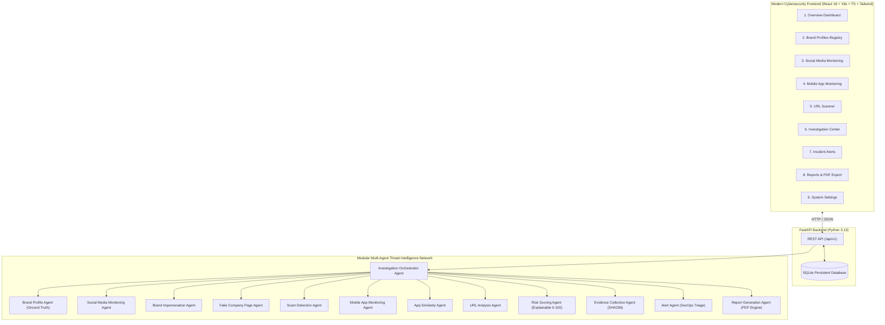

# BrandShield AI — Digital Risk Protection Platform
*Next-Generation Multi-Agent Cybersecurity Platform for Brand Impersonation, Phishing, and Rogue Asset Defense*

---

## 🛡️ Project Overview

**BrandShield AI** is an enterprise-grade Digital Risk Protection (DRP) and Brand Protection platform designed to counter digital deception targeting modern organizations. 

Organizations face evolving cyber threats: fake social media customer support accounts, typosquatting domains, credential-harvesting phishing portals, fake LinkedIn executive/recruiter profiles, and trojanized mobile applications.

BrandShield AI establishes an official brand registry of ground-truth corporate assets, automatically orchestrates a modular network of **specialist intelligence agents**, detects impersonation vectors, calculates an **explainable 0–100 risk score**, structures cryptographic evidence (SHA-256 IOCs), automates human-in-the-loop review workflows, and generates **official takedown incident PDF reports**.

---

## 🏛️ System Architecture



---

## 🤖 AI Specialist Agents

BrandShield AI employs a modular architecture featuring specialized autonomous agents:

| Agent | Category | Role & Capabilities |
| :--- | :--- | :--- |
| **Brand Profile Agent** | Ground Truth | Verifies target against registered corporate domains, handles, and mobile apps. Detects brand keyword proximity and aliases. |
| **Social Media Monitoring Agent** | Behavioral | Detects handle suffixes (`_support`, `_helpdesk`), follower-to-following anomalies, unverified claims, and off-platform evasions (Telegram/WhatsApp). |
| **Brand Impersonation Agent** | Pretexting | Uncovers semantic impersonation intent, executive spoofing, logo mimicry, and customer deception patterns. Enhanced with Gemini AI if configured. |
| **Fake Company Page Agent** | Recruitment | Detects fraudulent corporate directories on LinkedIn/Facebook, recruitment advance-fee scams, and unauthorized email domains (free Gmail/Yahoo vs corporate domain). |
| **Scam Detection Agent** | Linguistic Heuristics | Analyzes urgency tactics, fake cryptocurrency giveaways, wallet drainers, and active credential harvesting forms. |
| **Mobile App Monitoring Agent** | Static APK Audit | Audits app listings for dangerous Android permissions (`READ_SMS`, `RECEIVE_SMS`, `SYSTEM_ALERT_WINDOW`), missing privacy policies, and untrusted APK distributors. |
| **App Similarity Agent** | Developer Distance | Compares package names (`com.apexbank.mobile` vs typosquat package) and developer entity names against official registrations. |
| **URL Analysis Agent** | Network & Heuristics | Uncovers combosquatting, subdomain brand spoofing (`apexbank.secure-login.xyz`), high-risk TLDs (`.xyz`, `.top`, `.cfd`, `.ru`), and Shannon entropy (DGA domains). |
| **Risk Scoring Agent** | Explainable Math | Synthesizes agent findings into an explainable 0–100 score with itemized contributing factors and mitigating credits. |
| **Evidence Collection Agent** | Cryptographic Ledger | Generates SHA-256 hashes of indicators of compromise (IOCs), timelines, and artifacts for evidentiary integrity. |
| **Investigation Orchestrator** | Director | Manages the end-to-end investigation workflow: classification, agent execution, sufficiency checks, scoring, DB persistence, and human routing. |
| **Alert Agent** | Incident Dispatch | Routes High & Critical impersonations into real-time SecOps alert queues. |
| **Report Generation Agent** | Synthesis | Compiles technical methodology, executive summaries, threat indicators, and exports **ReportLab-powered PDF reports**. |

---

## 📊 Explainable Risk Scoring Model

Risk scores range from **0 to 100**, categorized into three triage tiers:
- 🟢 **Low Risk (0–39)**: Verified brand properties, benign community fan accounts with disclaimers, or low-similarity items.
- 🟡 **Medium Risk (40–69)**: Unofficial assets, parked combosquat domains, or ambiguous listings requiring passive monitoring.
- 🔴 **High Risk (70–100)**: Active credential harvesting forms, dangerous SMS interception permissions, verified logo theft, or executive pretexting.

Each case features a **Factor Contribution Breakdown** detailing the specific weights, score points, and technical rationale behind the score.

---

## 💻 Tech Stack

- **Frontend**: React 18, Vite, TypeScript, Tailwind CSS, Recharts, Lucide React
- **Backend**: Python 3.13, FastAPI, Pydantic v2, SQLAlchemy, ReportLab (PDF Generation), Pytest
- **Database**: SQLite persistent local storage (`brandshield.db`)
- **AI Intelligence**: Hybrid dual-engine (Gemini API LLM intelligence when configured + deterministic regex/homoglyph/entropy algorithms for standalone operation)

---

## 🚀 Exact Windows Setup & Running Instructions

### Prerequisites
- Python 3.10+ (Python 3.13 tested)
- Node.js 18+ (Node.js v24 tested) and npm

---

### Step 1: Start the FastAPI Backend

Open a PowerShell terminal:

```powershell
# Navigate to the backend directory
cd "C:\Users\L Sruthi\.gemini\antigravity\scratch\brandshield-ai\backend"

# (Optional) Set your Gemini API Key in environment or in a .env file:
# $env:GEMINI_API_KEY="AIzaSy..."

# Start the FastAPI server with Uvicorn
py -m uvicorn app.main:app --host 127.0.0.1 --port 8000 --reload
```

The backend will automatically initialize the SQLite database schema and seed high-fidelity synthetic demo data on first launch!
- **API Root**: `http://127.0.0.1:8000/`
- **Interactive Swagger Documentation**: `http://127.0.0.1:8000/docs`

---

### Step 2: Start the Vite React Frontend

Open a **second** PowerShell terminal:

```powershell
# Navigate to the frontend directory
cd "C:\Users\L Sruthi\.gemini\antigravity\scratch\brandshield-ai\frontend"

# Launch the development server
npm.cmd run dev
```

The terminal will display the local URL:
```
  VITE v8.3.4  ready in 250 ms

  ➜  Local:   http://localhost:5173/
  ➜  Network: use --host to expose
```

---

### Step 3: Open in Browser

Open your browser and navigate to:
👉 **`http://localhost:5173/`**

---

## 🧪 Running Automated Unit Tests

In the backend directory, run:

```powershell
cd "C:\Users\L Sruthi\.gemini\antigravity\scratch\brandshield-ai\backend"
py -m pytest tests/ -v
```

All 13 unit and integration tests will execute and pass:
```
tests/test_agents.py::test_text_similarity_and_homoglyphs PASSED
tests/test_agents.py::test_brand_profile_agent_official_match PASSED
tests/test_agents.py::test_social_media_agent_spoofed_support PASSED
tests/test_agents.py::test_url_analysis_agent_phishing PASSED
tests/test_agents.py::test_mobile_app_monitoring_agent PASSED
tests/test_agents.py::test_risk_scoring_agent PASSED
tests/test_api.py::test_root_endpoint PASSED
tests/test_api.py::test_health_endpoint PASSED
tests/test_api.py::test_dashboard_stats_endpoint PASSED
tests/test_api.py::test_list_brands_endpoint PASSED
tests/test_api.py::test_list_cases_endpoint PASSED
tests/test_api.py::test_settings_endpoint PASSED
tests/test_api.py::test_url_analysis_pipeline PASSED
======================= 13 passed in 1.25s =======================
```

---

## 🎯 Demonstration Scenarios

1. **Pre-Seeded Multi-Brand Simulation**:
   - **Apex Global Bank**: Banking portal with pre-configured official domain `apexbank.com`, verified handle `@apexbank`, and mobile app `com.apexbank.mobile`.
   - **CloudPulse SaaS**: Cloud infrastructure with official domains, GitHub, and Twitter.
   - **CyberGuard Security**: Defense cybersecurity firm.
   - **SwiftPay Financial**: P2P Payments network.

2. **Interactive Scanners**:
   - **Phishing URL Scanner**: Test `https://apexbank-auth-verify.xyz/login` with detected inputs `password, otp_code`. Watch the agents score 90+ High Risk.
   - **Social Impersonator Scanner**: Test `@apexbank_helpdesk` with bio pointing to `https://wa.me/...`. Observe authority spoofing and off-platform redirection flags.
   - **Mobile App Auditor**: Test `com.apex.banking.quick.pay` requesting `READ_SMS`. See the Trojan permissions alert.

3. **Human-in-the-Loop Review**:
   - Click on any case to open the **Investigation Case File**.
   - Review explainability factors and SHA-256 evidence items.
   - Switch to **Human Review & Verdict** tab, select status (e.g. `CONFIRMED_IMPERSONATION`), enter analyst notes, choose remediation action (e.g. `DMCA Takedown Requested`), and click **Save Review Verdict**.
   - Click **Export PDF Report** to download the official ReportLab incident document.

---

## ⚖️ Ethics & Cybersecurity Compliance Rules

- Risk scores represent **automated triage estimates**, not definitive legal proof of fraud.
- BrandShield AI adheres to strict **human review policies**: no automated account reporting, blocking, or accusation occurs without human analyst verification.
- Synthetic demo data is clearly marked to ensure ethical presentation without unauthorized third-party scraping.
