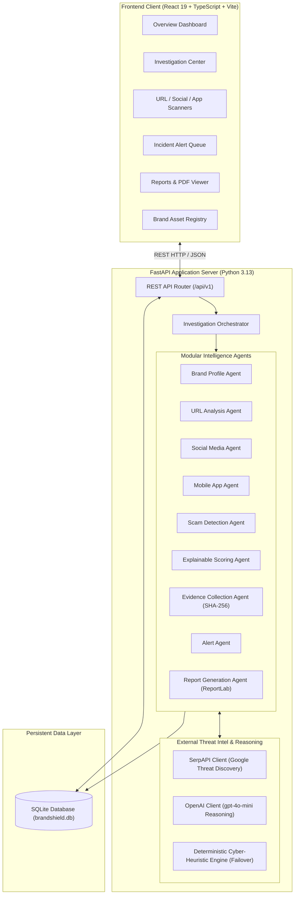

# BrandShield AI — Digital Risk Protection Platform (Kampus.VC)

> **Next-Generation Multi-Agent Cybersecurity Platform for Brand Impersonation, Phishing, and Rogue Asset Defense**

---

## 1. Project Title and Overview

**BrandShield AI** (also operating within the Kampus.VC Digital Risk Protection ecosystem) is an enterprise-grade cybersecurity and brand protection platform. It defends corporations, executive leadership, and customer communities against external digital deception, typosquatting domains, credential-harvesting phishing portals, fake executive profiles, rogue customer-support impersonators, and fraudulent mobile applications.

The platform establishes an authoritative ground-truth brand registry, coordinates a network of **autonomous specialist threat-intelligence agents**, computes an **explainable 0–100 risk score**, captures cryptographic indicators of compromise (SHA-256 IOCs), orchestrates human-in-the-loop triage, and compiles defensible **incident PDF reports** ready for registrar and platform takedown requests.

---

## 2. Problem Statement

Modern enterprise brands face continuous digital threats beyond their perimeter firewalls:
1. **Brand Impersonation & Pretexting**: Threat actors deploy fake social profiles impersonating customer service (`@brand_support`) or executives to deceive customers and partners into off-platform communication (e.g., Telegram, WhatsApp).
2. **Credential Harvesting & Phishing**: Typosquatted and combosquatted domains mimic official corporate login portals (`brand-verify-login.xyz`) to steal credentials, multi-factor authentication (MFA) tokens, or payment card details.
3. **Recruitment & Advance-Fee Fraud**: Fraudulent company pages on business networks post fake job listings and direct applicants to unofficial email domains (`@gmail.com` or spoofed domains) to collect identity documents or advance fees.
4. **Trojanized Mobile Applications**: Malicious APKs distributed on third-party repositories clone brand logos while demanding invasive permissions (`READ_SMS`, `RECEIVE_SMS`, `SYSTEM_ALERT_WINDOW`) to intercept one-time passwords.
5. **Slow Manual Incident Response**: Security Operations Center (SOC) analysts spend hours manually validating domains, calculating entropy, hashing evidence, and formatting takedown letters.

---

## 3. Project Objectives

- **Authoritative Ground-Truth Registry**: Store verified corporate domains, official social handles, and valid mobile app package IDs to prevent false accusations.
- **Autonomous Multi-Agent Investigation**: Automate technical audits (homoglyphs, Shannon entropy, APK permissions, bio analysis, linguistic urgency) across modular intelligence agents.
- **Deterministic & Explainable Risk Scoring**: Provide transparent, itemized score contributions (0–100 scale) with explicit reasoning rather than black-box verdicts.
- **Cryptographic Evidentiary Chain**: Generate SHA-256 digests and structured forensic timelines for every detected indicator.
- **Human-in-the-Loop Governance**: Ensure all high-impact actions (DMCA takedowns, registrar notices, escalation) require explicit analyst review and signed audit logs.
- **Real-Time Threat Ingestion**: Support live public web threat intelligence scans while gracefully falling back to deterministic cybersecurity heuristics when external LLM quotas are depleted.

---

## 4. Key Features

### 4.1 Digital Risk Monitoring Dashboard
- Live operational dashboard aggregating real-time risk telemetry directly from persistent storage.
- Key metrics: Total Cases Analyzed, Critical & High Risk Suspects, Active Unresolved Alerts, and Registered Brand Footprints.
- Real-time sync indicator distinguishing live database metrics from cached state.

### 4.2 Brand Impersonation Detection
- Semantic and structural analysis of public profiles, websites, and brand handles.
- Homoglyph and lookalike character detection (e.g., Cyrillic 'а' replacing Latin 'a', zero-width substitutions).
- Suffix/prefix spoofing identification (`-support`, `_helpdesk`, `_official`, `_claims`).
- Executive impersonation and recruiter pretexting detection.

### 4.3 Suspicious URL and Phishing Analysis
- In-depth URL lexical decomposition (TLD risk rating, Shannon entropy calculation for domain generation algorithms).
- Combosquatting detection identifying brand names buried in subdomains (`brand.secure-auth.xyz`).
- Inspection of login form inputs (`password`, `ssn`, `credit_card`, `otp_code`).
- Redirection chain auditing and suspicious protocol checks.

### 4.4 Social Media Profile Investigation
- Heuristic analysis of public profile metadata, handles, bios, and follower-to-following ratios.
- Extraction and flagging of off-platform evasion links (Telegram, WhatsApp, Bitly, Discord).
- Verification badge parity checking (unverified accounts claiming official authority).
- *Note: BrandShield AI inspects public metadata submitted for analysis; it does not scrape private accounts or violate platform terms of service.*

### 4.5 Threat Category Distribution
- Automatic classification of incidents into distinct categories:
  - `PHISHING`
  - `IMPERSONATION`
  - `ROGUE_APP`
  - `SCAM`
  - `SUSPICIOUS_DOMAIN`
- Interactive visual distribution charts powered by Recharts with dynamic percentages.

### 4.6 Risk Scoring and Critical Alerts
- Categorized risk tiers:
  - 🟢 **Low Risk (0–39)**: Benign community accounts, verified corporate properties, low-similarity listings.
  - 🟡 **Medium Risk (40–69)**: Ambiguous lookalikes, parked domains, unofficial fan channels.
  - 🔴 **High Risk (70–100)**: Active credential harvesters, trojanized mobile permissions, executive impersonators.
- Real-time alert dispatch routing High and Critical cases into the SecOps alert queue with acknowledge, dismiss, and bulk-read controls.

### 4.7 Investigation Management and Reports
- Case management center supporting search, severity filtering, status updates, and target-type classification.
- Interactive **Human Review & Verdict** tab allowing analysts to log notes, assign verdicts (`CONFIRMED_IMPERSONATION`, `FALSE_POSITIVE`, `SUSPICIOUS_MONITOR`), and record remediation actions (`DMCA Takedown Requested`, `Cease and Desist Sent`).
- **ReportLab PDF Export**: Instant generation of formal, cryptographically timestamped incident PDF dossiers for legal and hosting provider dispatch.

---

## 5. System Architecture



---

## 6. Technology Stack

### Frontend
- **Framework**: React 19.2.8
- **Language**: TypeScript 6.0.2
- **Build Tool**: Vite 8.3.4
- **Styling**: Tailwind CSS 3.4.17, PostCSS 8.5.29, Autoprefixer 10.6.1
- **Icons**: Lucide React 1.55.0
- **Data Visualization**: Recharts 3.10.1
- **Linter**: Oxlint 1.81.0

### Backend
- **Framework**: FastAPI 0.115.0+
- **ASGI Server**: Uvicorn 0.30.0+
- **Language**: Python 3.13.15
- **Data Validation & Settings**: Pydantic v2 (2.8.0+), Pydantic-Settings 2.4.0+
- **ORM & Database**: SQLAlchemy 2.0.30+, SQLite (Zero-configuration local storage)
- **HTTP Client**: HTTPX 0.27.0+
- **PDF Engine**: ReportLab 4.2.0+
- **Testing**: Pytest 8.3.0+, AnyIO 4.15.1

### External APIs & Intelligence
- **SerpAPI**: Live Google search threat discovery and public web asset indexing.
- **OpenAI API**: `gpt-4o-mini` cognitive threat reasoning.
- **Rule-based Heuristic Engine**: Built-in deterministic pattern matcher, Shannon entropy calculator, and homoglyph analyzer ensuring continuous functionality even when external APIs are rate-limited or unconfigured.

---

## 7. Project Folder Structure

```text
brandshield-ai/
├── .env.example                     # Root environment configuration template
├── .gitignore                       # Git exclusion list (protects secrets & db)
├── netlify.toml                     # Netlify deployment configuration for frontend
├── README.md                        # Project documentation
│
├── backend/                         # FastAPI Python Backend
│   ├── .env.example                 # Backend environment variable template
│   ├── brandshield.db               # SQLite database file (created on launch)
│   ├── requirements.txt             # Python backend dependencies
│   │
│   ├── app/                         # Application source code
│   │   ├── main.py                  # FastAPI entry point, CORS, lifespan startup
│   │   │
│   │   ├── api/v1/                  # REST API Endpoints
│   │   │   ├── alerts.py            # Alert listing, acknowledge, dismiss
│   │   │   ├── analyze.py           # Multi-agent threat analysis & SerpAPI search
│   │   │   ├── brands.py            # Brand registry CRUD & asset endpoints
│   │   │   ├── cases.py             # Investigation case queries & human review
│   │   │   ├── reports.py           # Investigation reports & PDF binary downloads
│   │   │   ├── settings.py          # System settings & connectivity tests
│   │   │   └── stats.py             # Live dashboard metrics & 7-day trend
│   │   │
│   │   ├── agents/                  # Autonomous intelligence agents
│   │   │   ├── base.py              # BaseAgent abstract class
│   │   │   ├── alert_agent.py       # Incident escalation and alerting
│   │   │   ├── app_similarity_agent.py # Mobile package & developer distance
│   │   │   ├── brand_profile_agent.py  # Ground-truth brand matching
│   │   │   ├── evidence_collection_agent.py # Cryptographic SHA-256 IOCs
│   │   │   ├── fake_company_page_agent.py   # Recruitment & company fraud
│   │   │   ├── gemini_client.py     # Optional Gemini API integration
│   │   │   ├── impersonation_agent.py # Brand lookalike & semantic mimicry
│   │   │   ├── mobile_app_agent.py  # Android permission & static APK audit
│   │   │   ├── orchestrator.py      # Investigation workflow coordinator
│   │   │   ├── report_generation_agent.py # Executive summary & PDF generator
│   │   │   ├── risk_scoring_agent.py # Explainable 0-100 mathematical scoring
│   │   │   ├── scam_detection_agent.py # Urgency & credential form detection
│   │   │   ├── social_media_agent.py # Handle spoofing & evasion link checks
│   │   │   └── url_analysis_agent.py # Shannon entropy, TLD risk, typosquats
│   │   │
│   │   ├── core/                    # Infrastructure & shared modules
│   │   │   ├── config.py            # Pydantic BaseSettings configuration
│   │   │   ├── database.py          # SQLAlchemy session & declarative engine
│   │   │   ├── openai_client.py     # Resilient OpenAI client with quota fallback
│   │   │   └── serpapi_client.py    # SerpAPI Google search threat client
│   │   │
│   │   ├── models/                  # SQLAlchemy ORM Models
│   │   │   ├── alert.py             # Security incident alerts table
│   │   │   ├── brand.py             # Registered brands and assets table
│   │   │   ├── case.py              # Cases, evidence items, score factors table
│   │   │   └── report.py            # Generated reports table
│   │   │
│   │   ├── schemas/                 # Pydantic Request & Response Schemas
│   │   │   ├── alert.py
│   │   │   ├── analysis.py
│   │   │   ├── brand.py
│   │   │   ├── case.py
│   │   │   └── report.py
│   │   │
│   │   └── services/                # Business logic & Database services
│   │       ├── alert_service.py
│   │       ├── analysis_service.py
│   │       ├── brand_service.py
│   │       ├── case_service.py
│   │       ├── demo_data_service.py # Seed data provider for instant demo
│   │       └── report_service.py    # ReportLab PDF synthesis
│   │
│   └── tests/                       # Automated Pytest suite
│       ├── test_agents.py           # 6 tests for individual intelligence agents
│       └── test_api.py              # 12 tests for endpoints, fallback, & PDF export
│
└── frontend/                        # Vite + React + TypeScript Frontend
    ├── package.json                 # Node.js dependencies & scripts
    ├── vite.config.ts               # Vite configuration
    ├── tsconfig.json                # TypeScript compiler configuration
    ├── tailwind.config.js           # Tailwind CSS theme and utility classes
    ├── index.html                   # HTML entry point
    │
    ├── public/                      # Static assets
    │   ├── _redirects               # Netlify SPA routing rules
    │   ├── favicon.svg
    │   └── icons.svg
    │
    └── src/                         # React application source code
        ├── App.tsx                  # Root component & navigation router
        ├── main.tsx                 # React DOM mount point
        ├── index.css                # Tailwind directives & global styling
        │
        ├── pages/                   # Application views
        │   ├── OverviewDashboard.tsx      # Main metrics, charts, & active cases
        │   ├── BrandProfiles.tsx          # Ground-truth corporate asset registry
        │   ├── SocialMediaMonitoring.tsx  # Social handle audit & live scanner
        │   ├── MobileAppMonitoring.tsx    # Mobile APK permission auditor
        │   ├── UrlScanner.tsx             # Lexical phishing & typosquat analyzer
        │   ├── InvestigationCenter.tsx    # Case triage, explainability, human review
        │   ├── AlertsPage.tsx             # Real-time incident alert center
        │   ├── ReportsPage.tsx            # PDF export & case report directory
        │   └── SettingsPage.tsx           # API key status & connectivity monitor
        │
        ├── components/              # Modular UI components
        │   ├── common/              # Status badges, cards, navigation header
        │   └── investigation/       # Explainable factor tree & review modal
        │
        ├── services/                # API communication
        │   └── api.ts               # Axios/Fetch wrapper connecting to backend
        │
        └── types/                   # TypeScript interfaces and data models
            └── index.ts
```

---

## 8. Prerequisites and Installation Instructions

### Prerequisites
- **Python**: Version 3.10 or higher (Python 3.13 tested and verified)
- **Node.js**: Version 18.0 or higher (Node.js 24 tested and verified)
- **Package Managers**: `pip` (Python) and `npm` (Node.js)
- **Git**: For version control

---

### Installation Steps

#### 1. Clone the Repository
```bash
git clone https://github.com/sruthilanke193-ctrl/BRANDSHIELD-AI.git
cd BRANDSHIELD-AI
```

#### 2. Backend Setup
Navigate to the `backend` folder and install dependencies:

```powershell
# Windows PowerShell
cd backend
py -m pip install -r requirements.txt
```

```bash
# Linux / macOS
cd backend
pip install -r requirements.txt
```

#### 3. Frontend Setup
Navigate to the `frontend` folder and install dependencies:

```powershell
# Windows PowerShell
cd ..\frontend
npm install
```

```bash
# Linux / macOS
cd ../frontend
npm install
```

---

## 9. Environment Variables

BrandShield AI utilizes environment variables for third-party intelligence configuration and operational thresholds. **Never commit raw API keys to public repositories.**

### Backend Configuration (`backend/.env`)
Copy the provided `.env.example` file to create your local `.env`:

```powershell
# Windows PowerShell
Copy-Item backend\.env.example backend\.env
```

```bash
# Linux / macOS
cp backend/.env.example backend/.env
```

| Variable | Required | Default | Description |
| :--- | :--- | :--- | :--- |
| `SERPAPI_API_KEY` | Optional | `""` | SerpAPI key for live Google web search threat discovery |
| `OPENAI_API_KEY` | Optional | `""` | OpenAI key for LLM cognitive analysis (`gpt-4o-mini`) |
| `OPENAI_MODEL` | Optional | `gpt-4o-mini` | Specific OpenAI model identifier |
| `GEMINI_API_KEY` | Optional | `""` | Google Gemini key for alternative LLM reasoning |
| `GEMINI_MODEL` | Optional | `gemini-1.5-flash` | Specific Gemini model identifier |
| `APP_ENV` | Optional | `development` | Deployment environment (`development` / `production`) |
| `DATABASE_URL` | Optional | `sqlite:///./brandshield.db` | Database connection string |
| `HIGH_RISK_THRESHOLD` | Optional | `70` | Numeric score (0–100) triggering High/Critical triage |
| `MEDIUM_RISK_THRESHOLD`| Optional | `40` | Numeric score (0–100) triggering Medium warning |
| `DEFAULT_REVIEWER` | Optional | `SecOps Analyst (Tier 2)` | Default audit author for human verdicts |

### Frontend Configuration (`frontend/.env`)
Create an optional `frontend/.env` to override the API target:

```ini
VITE_API_BASE_URL=http://127.0.0.1:8000/api/v1
```
*If omitted, the frontend automatically defaults to `http://127.0.0.1:8000/api/v1` in local development.*

---

## 10. Exact Commands to Run Frontend and Backend

### Terminal 1: Run Backend Server
```powershell
# Windows PowerShell
cd "C:\Users\L Sruthi\.gemini\antigravity\scratch\brandshield-ai\backend"
py -m uvicorn app.main:app --host 127.0.0.1 --port 8000 --reload
```

```bash
# Linux / macOS
cd backend
uvicorn app.main:app --host 127.0.0.1 --port 8000 --reload
```

- **Backend Health Check**: `http://127.0.0.1:8000/health`
- **Interactive Swagger Documentation**: `http://127.0.0.1:8000/docs`
- **OpenAPI JSON Spec**: `http://127.0.0.1:8000/openapi.json`

---

### Terminal 2: Run Frontend Application
```powershell
# Windows PowerShell
cd "C:\Users\L Sruthi\.gemini\antigravity\scratch\brandshield-ai\frontend"
npm run dev
```

```bash
# Linux / macOS
cd frontend
npm run dev
```

- **Application Web UI**: Open your browser to `http://localhost:5173/` (or the port indicated in your Vite console, such as `http://localhost:5174/`).

---

## 11. API Endpoints

All application routes are documented interactively in Swagger UI at `/docs`. Below is the complete catalog of actual backend endpoints:

### System & Health Endpoints
- `GET /` — Platform identification and operational status
- `GET /health` — Health check endpoint verifying database connectivity

### Dashboard Statistics (`/api/v1/stats`)
- `GET /api/v1/stats/dashboard` — Live dashboard metrics, threat category distribution, and 7-day risk volume trends

### Brand Profile Management (`/api/v1/brands`)
- `GET /api/v1/brands/` — Retrieve all registered corporate brands and ground-truth footprints
- `POST /api/v1/brands/` — Register a new brand profile
- `GET /api/v1/brands/{brand_id}` — Retrieve detailed brand profile with official assets
- `POST /api/v1/brands/{brand_id}/assets` — Register an official domain, social handle, or app ID
- `DELETE /api/v1/brands/{brand_id}/assets/{asset_id}` — Delete a specific registered brand asset
- `DELETE /api/v1/brands/{brand_id}` — Delete a brand profile and all associated data

### Threat Analysis Scanners (`/api/v1/analyze`)
- `POST /api/v1/analyze/url` — Trigger multi-agent investigation on a suspicious URL / phishing domain
- `POST /api/v1/analyze/social` — Trigger multi-agent investigation on a public social profile
- `POST /api/v1/analyze/mobile-app` — Trigger static audit on a suspicious mobile application listing
- `POST /api/v1/analyze/company-page` — Trigger investigation on a fraudulent company directory or recruiter profile
- `POST /api/v1/analyze/web-search` — Scan public search engines via SerpAPI for brand impersonations and active scams

### Investigation Case Management (`/api/v1/cases`)
- `GET /api/v1/cases/` — Query investigation cases with filtering by `brand_id`, `risk_level`, `target_type`, `status`, search text, and pagination
- `GET /api/v1/cases/{case_id}` — Retrieve comprehensive case file including factor explainability, agent telemetry, and SHA-256 evidence items
- `PUT /api/v1/cases/{case_id}/review` — Update human analyst review verdict, analyst notes, and remediation action taken

### Security Incident Alerts (`/api/v1/alerts`)
- `GET /api/v1/alerts/` — Retrieve active security incident alerts filtered by brand or severity
- `PUT /api/v1/alerts/{alert_id}/read` — Mark an alert as read
- `PUT /api/v1/alerts/{alert_id}/dismiss` — Dismiss an alert from active view
- `POST /api/v1/alerts/mark-all-read` — Mark all active alerts as read

### Reports & PDF Generation (`/api/v1/reports`)
- `GET /api/v1/reports/` — List all compiled investigation reports
- `GET /api/v1/reports/{report_id}` — Retrieve report details, executive summary, and indicator lists
- `GET /api/v1/reports/{report_id}/pdf` — Stream and download the formal ReportLab PDF dossier
- `GET /api/v1/reports/case/{case_id}/pdf` — Stream and download formal PDF dossier by Case ID

### System Settings & Diagnostics (`/api/v1/settings`)
- `GET /api/v1/settings/` — Retrieve active engine status, thresholds, and configured integrations
- `GET /api/v1/settings/test-serpapi` — Verify SerpAPI connection or receive configuration steps
- `GET /api/v1/settings/test-openai` — Verify OpenAI connection or receive configuration steps
- `GET /api/v1/settings/test-gemini` — Verify Gemini connection or receive configuration steps
- `POST /api/v1/settings/seed-demo-data` — Reset and seed the database with realistic demonstration cases

---

## 12. Real Threat Intelligence Integrations and Their Limitations

BrandShield AI operates with a resilient hybrid intelligence architecture designed to remain operational under real-world operational constraints:

| Integration | Current Operational Status | Actual Role & Behavior | Documented Limitation |
| :--- | :--- | :--- | :--- |
| **SerpAPI** | **Active & Configured** | Queries Google Search via SerpAPI to discover live organic listings, typosquatting domains, and fraudulent landing pages. | Rate-limited by account query plan. Scans public index results only. |
| **OpenAI API** | **Configured (HTTP 429 Failover)** | Formulates cognitive threat assessments and structured summaries using `gpt-4o-mini`. | External account credit limits can be reached. Handled transparently by automatic heuristic fallback without crashing. |
| **Gemini API** | **Client Ready (Optional)** | Modular integration file exists (`gemini_client.py`) for alternative LLM evaluation. | Unconfigured by default unless `GEMINI_API_KEY` is provided in environment. |
| **Cyber-Heuristic Engine** | **Active (Primary Resilient Core)** | Performs deterministic regex checks, Shannon entropy, homoglyph replacement, dangerous APK permission scanning, and scoring. | Operates on input parameters and static rules; does not independently crawl JavaScript or render headless browsers. |

### Ethical and Technical Limitations
- **No Private Scraping**: BrandShield AI does not scrape private social media profiles or bypass authentication walls. All analysis evaluates public indicators or analyst-submitted metadata.
- **Triage vs. Legal Verdict**: Automated risk scores represent technical triage assessments. They do not constitute formal legal judgments until verified by a certified human analyst.

---

## 13. Testing Instructions and Actual Test Status

BrandShield AI maintains an automated Pytest test suite covering agent algorithms, API endpoints, error handling, heuristic fallback, and PDF report synthesis.

### Run Automated Tests
```powershell
# Windows PowerShell
cd "C:\Users\L Sruthi\.gemini\antigravity\scratch\brandshield-ai\backend"
py -m pytest tests/ -v
```

```bash
# Linux / macOS
cd backend
pytest tests/ -v
```

### Actual Test Status: 18 Passed (100% Pass Rate)

```text
tests/test_agents.py::test_text_similarity_and_homoglyphs PASSED         [  5%]
tests/test_agents.py::test_brand_profile_agent_official_match PASSED     [ 11%]
tests/test_agents.py::test_social_media_agent_spoofed_support PASSED     [ 16%]
tests/test_agents.py::test_url_analysis_agent_phishing PASSED            [ 22%]
tests/test_agents.py::test_mobile_app_monitoring_agent PASSED            [ 27%]
tests/test_agents.py::test_risk_scoring_agent PASSED                     [ 33%]
tests/test_api.py::test_root_endpoint PASSED                             [ 38%]
tests/test_api.py::test_health_endpoint PASSED                           [ 44%]
tests/test_api.py::test_dashboard_stats_endpoint PASSED                  [ 50%]
tests/test_api.py::test_list_brands_endpoint PASSED                      [ 55%]
tests/test_api.py::test_list_cases_endpoint PASSED                       [ 61%]
tests/test_api.py::test_settings_endpoint PASSED                         [ 66%]
tests/test_api.py::test_integration_test_endpoints PASSED                [ 72%]
tests/test_api.py::test_web_search_missing_key_behavior PASSED           [ 77%]
tests/test_api.py::test_url_analysis_pipeline PASSED                     [ 83%]
tests/test_api.py::test_social_analysis_pipeline PASSED                  [ 88%]
tests/test_api.py::test_mobile_app_analysis_pipeline PASSED              [ 94%]
tests/test_api.py::test_human_review_and_pdf_export PASSED               [100%]

======================= 18 passed, 8 warnings in 6.43s =======================
```

### Frontend Production Build Verification
To verify the frontend TypeScript and Vite bundle without errors:

```powershell
cd "C:\Users\L Sruthi\.gemini\antigravity\scratch\brandshield-ai\frontend"
npm run build
```
Output:
```text
✓ 2498 modules transformed.
dist/index.html                   1.06 kB │ gzip:   0.64 kB
dist/assets/index-DWiLiuyX.css   28.02 kB │ gzip:   5.90 kB
dist/assets/index-Dd6iiBsn.js   736.01 kB │ gzip: 203.48 kB
✓ built in 762ms
```

---

## 14. Deployment Instructions

### Frontend Deployment: Netlify
The repository is pre-configured for Netlify deployment via `netlify.toml` and `frontend/public/_redirects`:

1. **Repository Link**: Push your code to GitHub and connect the repository in the Netlify Dashboard.
2. **Build Settings**:
   - **Base directory**: `frontend`
   - **Build command**: `npm run build`
   - **Publish directory**: `dist`
3. **Environment Variables**:
   - `VITE_API_BASE_URL`: Set to your deployed Render backend URL (e.g., `https://brandshield-backend.onrender.com/api/v1`).
4. **Single-Page Application Routing**: Managed automatically by `netlify.toml`:
   ```toml
   [build]
     base = "frontend"
     publish = "dist"
     command = "npm run build"

   [[redirects]]
     from = "/*"
     to = "/index.html"
     status = 200
   ```

---

### Backend Deployment: Render
The FastAPI backend is configured for deployment as a Render Web Service:

1. **Create Web Service**: In the Render Dashboard, create a new **Web Service** connected to your repository.
2. **Environment & Runtime**:
   - **Runtime**: `Python 3`
   - **Root Directory**: `backend`
   - **Build Command**: `pip install -r requirements.txt`
   - **Start Command**: `uvicorn app.main:app --host 0.0.0.0 --port $PORT`
3. **Environment Variables**:
   - `APP_ENV`: `production`
   - `CORS_ORIGINS`: Add your Netlify URL (e.g., `https://your-site.netlify.app`).
   - `SERPAPI_API_KEY`: *(Optional)* Your SerpAPI production key.
   - `OPENAI_API_KEY`: *(Optional)* Your OpenAI production key.
   - `DATABASE_URL`: `sqlite:///./brandshield.db` (or a managed PostgreSQL instance for horizontal scaling).
4. **Health Check Path**: `/health`

---

## 15. Security Considerations

- **Strict Secret Management**: `.env` and `*.db` files are strictly excluded via `.gitignore`. No live production secrets or private keys are committed.
- **CORS Protection**: The backend CORS middleware explicitly validates approved origin domains, local development ports, and Netlify subdomains via `allow_origin_regex=r"https://.*\.netlify\.app"`.
- **Cryptographic Evidence Integrity**: Every logged indicator of compromise receives an immutable SHA-256 hash at detection time to preserve evidentiary integrity for legal proceedings.
- **Fail-Safe Resilience**: When external third-party AI APIs return errors or rate limits (e.g., HTTP 429), the application seamlessly transitions to deterministic rule-based algorithms without service disruption.
- **Human-in-the-Loop Safeguards**: Automated scanners highlight threats and calculate scores, but takedown requests and external escalations require explicit human confirmation.

---

## 16. Current Limitations and Future Enhancements

### Current Limitations
1. **API Quota Sensitivity**: Third-party LLM features depend on available OpenAI or Gemini token balances.
2. **Static APK Inspection**: Mobile app analysis evaluates package identifiers, store listings, and manifest permissions, rather than executing full dynamic sandbox emulation.
3. **Single-Node SQLite Storage**: Default configuration uses local SQLite storage suitable for single-instance deployments. Multi-instance scaling requires migrating to PostgreSQL.

### Future Enhancements (Planned Features)
- [ ] **URLhaus (abuse.ch) Feed Integration**: Automated synchronization with daily malicious URL feeds.
- [ ] **Google Safe Browsing v4 API**: Direct endpoint verification for known malware and social engineering URLs.
- [ ] **Automated WHOIS / RDAP Registrar Lookup**: Real-time extraction of domain registration dates, privacy proxy statuses, and registrar abuse contact emails.
- [ ] **Headless Chromium Screenshot Capture**: Visual rendering and logo perceptual hashing (pHash) against official registered brand logos.
- [ ] **Automated Abuse Desk Email Dispatch**: Direct submission of takedown notices to hosting providers via standardized RFC abuse formats.

---

## 17. License

A license has not been specified for this project. All rights are reserved by the original authors and Kampus.VC. For permissions or licensing inquiries, please contact the project maintainers.
